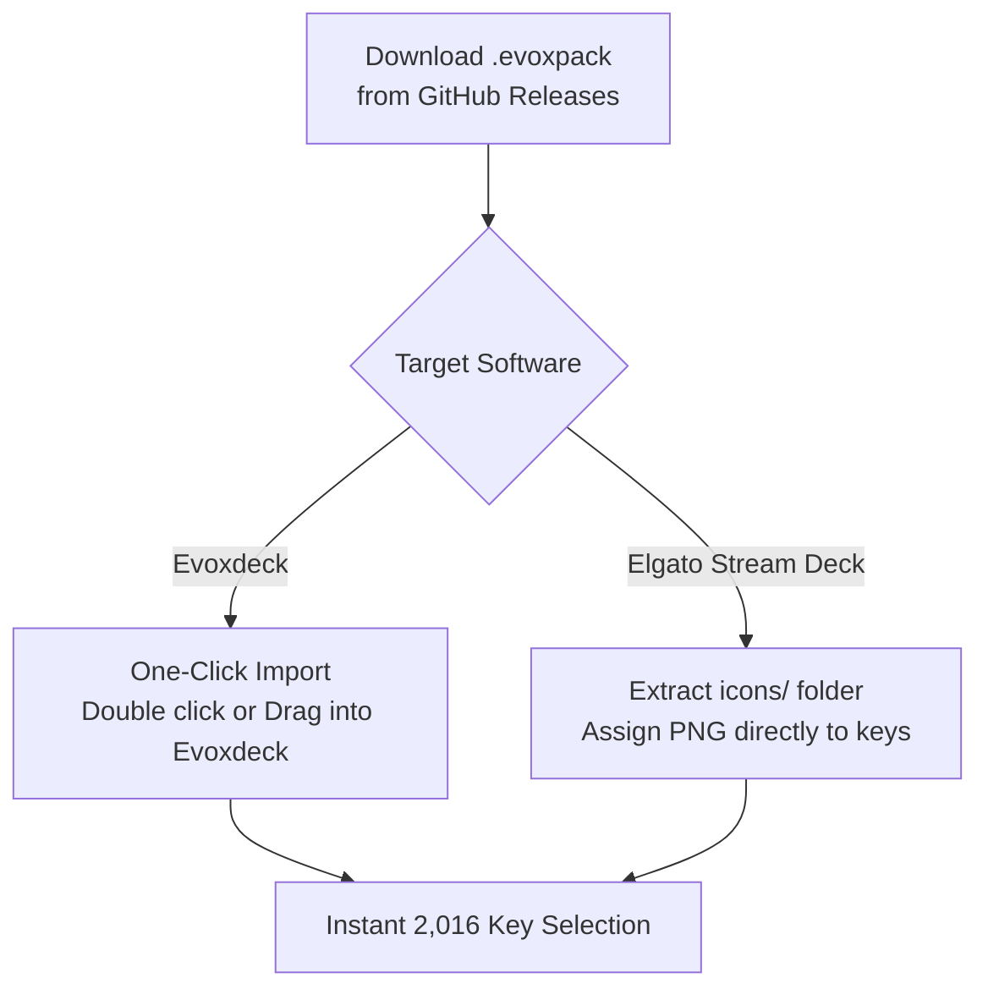

  
  <h1>Galaxy Icons - Cosmic Edition</h1>
  
<strong>2,016 Deep Cosmic Nebula Stream Deck & Evoxdeck Squircle Icons (Nebula Pink, Cosmic Purple, Deep Indigo, Obsidian Void).</strong>

  

    <strong>Language:</strong> <a href="README.md"><strong>EN</strong></a> | <a href="README.tr.md"><strong>TR</strong></a>
    &nbsp;•&nbsp;
    <a href="https://github.com/Hfatih/galaxy-icons-cosmic/releases/latest">Download .evoxpack</a> ·
    <a href="https://hfatih.github.io/galaxy-icons-cosmic/">Live Interactive Gallery</a> ·
    <a href="#how-to-install">How to Install</a>
  

  

    
    
    
    
    
    
  

  

    
    
    
    
    
  

---

## Overview

**Galaxy Icons - Cosmic Edition** is an ultra-premium, cosmic deep-space icon pack crafted specifically for **Elgato Stream Deck**, **Evoxdeck**, **Loupedeck**, and **Touch Portal**.

Each icon is rendered on a precision superellipse ($p=3.6, r=52$) squircle base at Retina $128\times 128$ resolution, combining radiant space nebula gas clouds, sparkling celestial stardust (✦), and polished glass rim reflections.

### 🌐 Live Interactive Web Gallery
You can preview, search, filter and experience all 2,016 icons directly in your web browser:
👉 **[Open Live Gallery on GitHub Pages](https://hfatih.github.io/galaxy-icons-cosmic/)**

---

## Showcase

| Stream Deck Live Mockup & Key Matrix |
| :---: |
|  |
| *2,016 icons across 4 deep space color palettes featuring radiant cosmic gradients, crisp solid white vectors, and celestial stardust.* |

---

## 4 Cosmic Stellar Themes (504 Icons Each)

| Theme Name | Slug | Top-Left RGB | Bottom-Right RGB | Hex Gradient |
| :--- | :--- | :--- | :--- | :--- |
| **Nebula Pink** | `nebula-pink` | `rgb(252, 92, 196)` | `rgb(205, 110, 240)` | `#fc5cc4` ➔ `#cd6ef0` |
| **Cosmic Purple** | `cosmic-purple` | `rgb(204, 110, 248)` | `rgb(125, 75, 180)` | `#cc6ef8` ➔ `#7d4bb4` |
| **Deep Indigo** | `deep-indigo` | `rgb(110, 70, 180)` | `rgb(50, 45, 135)` | `#6e46b4` ➔ `#322d87` |
| **Obsidian Void** | `obsidian-void` | `rgb(55, 50, 140)` | `rgb(16, 14, 45)` | `#37328c` ➔ `#100e2d` |

---

## Curated Symbol Categories (504 Glyphs × 4 Themes)

1. **🎙️ Audio & Voice Controls:** Mic, Headphones, Volume (0-1-2-Mute), Bell, Soundlines, Waveforms, Equalizer, Mixer, Subwoofers.
2. **🎵 Media & Music:** Play, Pause, Skip, Rewind, Shuffle, Repeat, Disc, Radio, Podcast, Guitar, Camera, Video, Spotify, Apple Music, FL Studio, Audacity.
3. **⭐ Streamer Badges:** REC, LIVE, Game Audio, Music Audio, Mute, Deaf, Mic On, GG, VIP, MOD, Clutch, AFK, Hype, Sub, Chat, Poll, Clip, Trophy, Crown, Flame, Zap.
4. **🎮 Gaming & Esports:** Minecraft, Valorant, League of Legends, PlayStation, Xbox, Nintendo Switch, Steam, Epic Games, Gamepad, Joystick, Swords, Battle Axe, Bomb, Crosshair, Dices.
5. **📱 Social & Creator Platforms:** YouTube, Twitch, Discord, TikTok, Instagram, Twitter/X, Facebook, Kick, Reddit, Telegram, WhatsApp, OBS Studio, Streamlabs, Blender.
6. **⚙️ System & Hardware:** CPU, GPU, RAM, Monitor, Laptop, Mouse, Keyboard, WiFi, Bluetooth, Clock, Timer, Power, Lock, Settings.

---

## How to Install

### 1. Evoxdeck (Recommended)
1. Download `Galaxy Icons - Cosmic Edition.evoxpack` from [Releases](https://github.com/Hfatih/galaxy-icons-cosmic/releases/latest).
2. Double-click the file or open **Evoxdeck** ➔ **Settings** ➔ **Icon Packs** ➔ **Import Pack**.
3. All 2,016 icons and categories will appear instantly in your Evoxdeck library.

### 2. Elgato Stream Deck
1. Extract `icons/` folder from the repository or `.evoxpack`.
2. In the Elgato Stream Deck configuration software, drag and drop any PNG onto a key slot.

---

## Package Specification (`manifest.json`)

- `schemaVersion`: `1`
- `packageType`: `icon_pack`
- `coverImage`: `cover.png` (256×256 Retina squircle)
- `assets/icons/`: 2,016 individual PNG icons ($128\times 128$ px, 32-bit RGBA)

---

## License

Distributed under the **MIT License**. Free for personal and commercial stream setups.
Authored with 💖 by **[Fatih Han](https://github.com/Hfatih)**.
