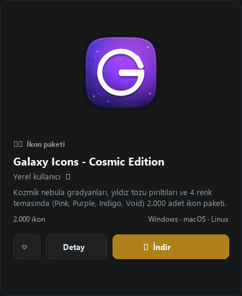
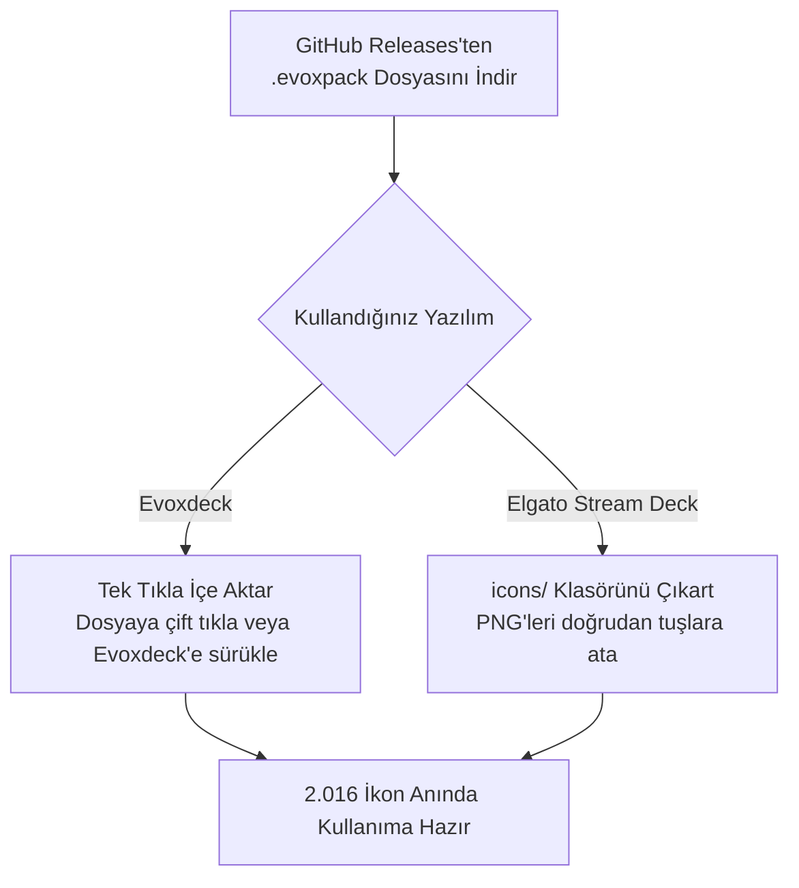

  
  <h1>Galaxy Icons - Cosmic Edition</h1>
  
<strong>2.016 Adet Kozmik Derin Uzay Stream Deck & Evoxdeck İkon Paketi (Nebula Pink, Cosmic Purple, Deep Indigo, Obsidian Void).</strong>

  

    <strong>Dil:</strong> <a href="README.md"><strong>EN</strong></a> | <a href="README.tr.md"><strong>TR</strong></a>
    &nbsp;•&nbsp;
    <a href="https://github.com/Hfatih/galaxy-icons-cosmic/releases/latest">.evoxpack İndir</a> ·
    <a href="https://hfatih.github.io/galaxy-icons-cosmic/">Canlı Web Galerisi</a> ·
    <a href="#kurulum">Nasıl Kurulur?</a>
  

  

    
    
    
    
    
    
  

  

    
    
    
    
    
  

---

## Genel Bakış

**Galaxy Icons - Cosmic Edition**, **Elgato Stream Deck**, **Evoxdeck**, **Loupedeck** ve **Touch Portal** cihazları için özel olarak tasarlanmış, derin uzay ve nebula temalı ultra lüks bir ikon koleksiyonudur.

Her ikon, Retina $128\times 128$ çözünürlükte, matematiksel süperelips ($p=3.6, r=52$) squircle taban üzerinde, zengin nebula gaz bulutları, 4 köşeli parlak anime yıldız ışıltıları (✦) ve cam kenar parlamalarıyla render edilmiştir.

### 🌐 Canlı Web Deneyimi & Galeri
Hiçbir dosya indirmeden 2.016 ikonun tamamını doğrudan tarayıcınızda arayabilir, filtreleyebilir ve inceleyebilirsiniz:
👉 **[GitHub Pages Üzerinde Galeriyi Aç](https://hfatih.github.io/galaxy-icons-cosmic/)**

---

## Vitrin & Önizleme

| Stream Deck Canlı Tuş Dizilimi |
| :---: |
|  |
| *Nebula Pink, Cosmic Purple, Deep Indigo ve Obsidian Void tuşları üzerinde saf beyaz vektör glifler ve parlak yıldız tozu.* |

---

## 4 Kozmik Renk Teması (Her Temada 504 İkon)

| Tema Adı | Kod | Sol-Üst RGB | Sağ-Alt RGB | Hex Gradyan |
| :--- | :--- | :--- | :--- | :--- |
| **Nebula Pink** | `nebula-pink` | `rgb(252, 92, 196)` | `rgb(205, 110, 240)` | `#fc5cc4` ➔ `#cd6ef0` |
| **Cosmic Purple** | `cosmic-purple` | `rgb(204, 110, 248)` | `rgb(125, 75, 180)` | `#cc6ef8` ➔ `#7d4bb4` |
| **Deep Indigo** | `deep-indigo` | `rgb(110, 70, 180)` | `rgb(50, 45, 135)` | `#6e46b4` ➔ `#322d87` |
| **Obsidian Void** | `obsidian-void` | `rgb(55, 50, 140)` | `rgb(16, 14, 45)` | `#37328c` ➔ `#100e2d` |

---

## Kategoriler (504 Sembol × 4 Tema)

1. **🎙️ Ses & Mikrofon Kontrolleri:** Mikrofon, Kulaklık, Ses Seviyeleri (0-1-2-Mute), Bildirim Zili, Dalga Boyu Grafikleri, Ekolayzer, Mixer.
2. **🎵 Medya & Müzik:** Oynat, Duraklat, İleri, Geri, Karıştır, Tekrarla, Plak, Radyo, Podcast, Gitar, Kamera, Video, Spotify, Apple Music, FL Studio.
3. **⭐ Yayıncı Rozetleri:** REC, LIVE, Game Audio, Music Audio, Mute, Deaf, Mic On, GG, VIP, MOD, Clutch, AFK, Hype, Sub, Chat, Poll, Clip, Kupa, Taç, Alev, Şimşek.
4. **🎮 Oyun & Espor:** Minecraft, Valorant, League of Legends, PlayStation, Xbox, Nintendo Switch, Steam, Epic Games, Gamepad, Joystick, Çift Kılıç, Savaş Baltası, Bomba, Nişangah, Zarlar.
5. **📱 Sosyal Medya & Platformlar:** YouTube, Twitch, Discord, TikTok, Instagram, Twitter/X, Facebook, Kick, Reddit, Telegram, WhatsApp, OBS Studio, Streamlabs, Blender.
6. **⚙️ Sistem & Donanım:** CPU, GPU, RAM Bellek, Monitör, Laptop, Mouse, Klavye, WiFi, Bluetooth, Saat, Zamanlayıcı, Güç, Kilit, Ayarlar.

---

## Kurulum

### 1. Evoxdeck (Önerilen)
1. [Releases](https://github.com/Hfatih/galaxy-icons-cosmic/releases/latest) sayfasından `Galaxy Icons - Cosmic Edition.evoxpack` dosyasını indirin.
2. Dosyaya çift tıklayın veya **Evoxdeck** ➔ **Ayarlar** ➔ **İkon Paketleri** ➔ **Paket İçe Aktar** yolunu izleyin.
3. 2.016 ikon anında kütüphanenize yüklenir.

### 2. Elgato Stream Deck
1. Depodaki `icons/` klasörünü açın.
2. Elgato Stream Deck yazılımında istediğiniz PNG dosyasını tuş yuvasına sürükleyip bırakın.

---

## Lisans

**MIT Lisansı** altında sunulmaktadır. Kişisel ve ticari yayınlarda serbestçe kullanılabilir.
💖 **[Fatih Han](https://github.com/Hfatih)** tarafından sevgiyle hazırlandı.
